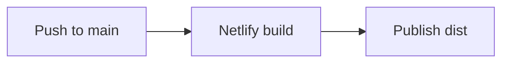

# Math Book Navigator

A study tool for IB Mathematics: Applications and Interpretation SL and HL. Find an exercise, then read its questions beside the printed answers without flipping between pages.

- Search by exercise code, review set, or topic.
- Read continuous PDF sections in resizable question and answer panes.
- Jump between questions, zoom each pane, and hide answers.
- Resume recent sections with reading positions saved in your browser.
- Choose light, dark, or system appearance and six color themes.
- Copy a question image and open Google AI with its context. Paste or upload the image there yourself; no API key is required.

## Run locally

You need Node.js 18 or newer, npm, and Python 3.

```sh
npm ci
npm run build
npm run dev
```

Open [localhost:5818](http://localhost:5818), then select SL or HL. After installing dependencies and building, macOS users can also run `Open Math Book.command` to start the local server and open the site.

The exercise catalogs are included. To read locally, supply the matching source PDFs in the repository root as `math_book_sl.pdf` (SL, 505 pages) and `math_book_indexed.pdf` (HL, 969 pages). The catalogs depend on these editions and page layouts; arbitrary PDFs will not match. You only need the PDF for the course you want to use. PDFs are kept locally and ignored by Git.

## Build and host

`npm run build` generates the static site in `dist/`, which is ignored by Git. `netlify.toml` configures Netlify to run that command with Node.js 22 and publish `dist/`.

Link the existing Netlify project to this GitHub repository under **Project configuration → Developer settings → Continuous deployment → Repository**, using `main` as the production branch. Once connected, each push to `main` builds and deploys the site automatically. No separate upload folder or deployment token in the repository is needed.



For another static host, publish the contents of `dist/`.

The hosted build loads PDF chunks from the existing Cloudflare PDF host, `https://simon-math-book-pdf.pages.dev/pdf`, configured in `src/home.mjs` and `src/study.mjs`. It requires that host to remain available. To use your own PDF host, update those URLs and the fallback links in `index.html`. Split each matching PDF into consecutive 64-page chunks (the final chunk is shorter), named `book-0001-0064.pdf`, `book-0065-0128.pdf`, etc. for HL, and `sl-book-0001-0064.pdf`, etc. for SL. Preserve original page order and allow cross-origin requests. The local full PDFs and hosted PDF chunks are separate from the application code.

## Development

The app uses vanilla JavaScript, CSS, PDF.js, Fuse.js, and Floating UI. Edit `src/` for the main catalog and study views, the root helper modules for shared behavior, and `site-ui.css` for styling. The root `home.mjs`, `study.mjs`, `search.mjs`, and `question-actions.mjs` are generated bundles.

```sh
npm run format
npm run format:check
npm run build
```

Formatting applies to maintained source files; generated bundles and third-party assets retain their build formatting. Rebuild after source changes to update the local bundles and `dist/`. Third-party licenses and notices are in `THIRD-PARTY-NOTICES.txt` and `vendor/pdfjs/`.
